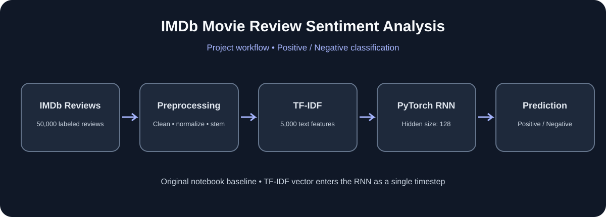
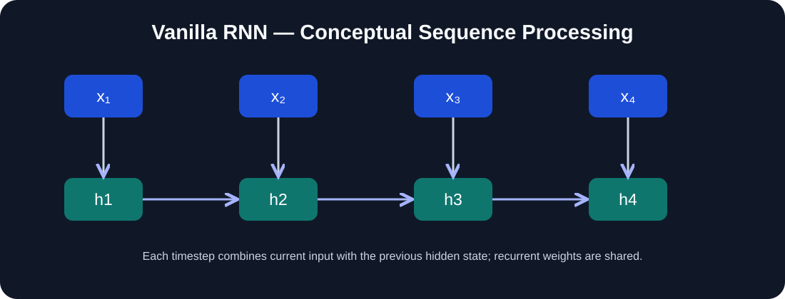
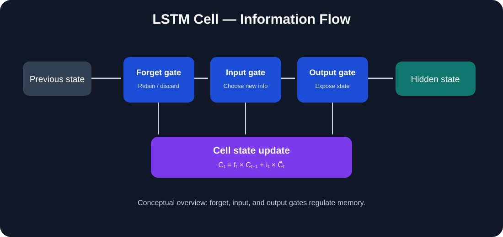

# IMDb Movie Review Sentiment Analysis with PyTorch RNN

A hands-on Natural Language Processing (NLP) project that classifies IMDb movie reviews as **positive** or **negative** using a PyTorch Recurrent Neural Network (RNN).

This repository preserves the original implementation as a baseline and documents a planned extension to a true word-sequence RNN. The two approaches will be kept separate so the original work and its results remain reproducible.

## Project visuals

### End-to-end project workflow



### RNN architecture (conceptual)



### LSTM architecture (conceptual learning reference)



> The diagrams distinguish the original notebook's TF-IDF + one-timestep RNN baseline from the conceptual word-sequence RNN and LSTM architectures covered in `RNN_Learning/`.

## Project objective

Given a movie review, predict its sentiment:

- `0` — Negative
- `1` — Positive

## Dataset

- **Dataset:** IMDb Movie Reviews
- **Original size:** 50,000 reviews
- **Columns:** `review`, `sentiment`
- **Rows after duplicate removal in the original notebook:** 49,582

The repository includes the dataset file `IMDB Dataset.csv` in the root directory. It is approximately 63 MB. It is intentionally kept at the root because the original notebook loads it by filename from the project working directory. See [dataset notes](docs/dataset.md) before moving or renaming it.

## Original implementation: TF-IDF + PyTorch RNN

The notebook `RNN_for_sentimentanalysis.ipynb` contains the original experiment.

### Workflow

1. Load the CSV dataset with Pandas and inspect its shape, sample records, and missing values.
2. Remove duplicate records.
3. Clean review text by lowercasing and removing URLs, punctuation, and HTML markup.
4. Remove English stopwords with NLTK.
5. Apply Porter stemming.
6. Encode sentiment labels with Scikit-learn's `LabelEncoder`.
7. Convert reviews into numerical features with `TfidfVectorizer(max_features=5000)`.
8. Split the data into training and testing sets using an 80/20 split and `random_state=42`.
9. Convert the feature arrays and labels into PyTorch tensors and create `TensorDataset` and `DataLoader` objects.
10. Define a PyTorch `nn.RNN` model with a hidden size of 128 and a linear output layer.
11. Train using binary cross-entropy loss and the Adam optimizer for 10 epochs.
12. Evaluate predictions on the held-out test set.

### Original result

**Test accuracy recorded in the original notebook: 85.16%.**

See [baseline results](results/baseline_results.md) for the experiment configuration and notes on which metrics have not yet been verified.

This is the result from the original experiment; it should not be interpreted as the result of the planned sequence-based model.

### Important architecture detail

The original notebook adds a sequence dimension to each TF-IDF vector with `unsqueeze(1)`. The resulting input shape is:

```text
(batch_size, 1, 5000)
```

So the RNN receives a sequence of **one timestep**, where the 5,000 TF-IDF values form the input at that timestep. It is a valid RNN-based experiment, but it does **not** read the review word by word or model word-order dependencies across multiple timesteps.

### Preprocessing note

During review of the original preprocessing code, stopword removal using repeated string replacement was identified as a potential text-corruption issue. For example, removing a stopword substring can alter a different word that contains the same character sequence. This behavior should be corrected in a separately documented improvement rather than silently changing the original experiment.

## Planned extension: true sequence-based RNN

The next notebook will implement a separate word-sequence pipeline:

1. Clean and tokenize each review.
2. Build a vocabulary from the training split only.
3. Convert tokens into integer IDs.
4. Pad or truncate reviews to a fixed sequence length.
5. Use an embedding layer to map token IDs to dense vectors.
6. Pass the sequence through a vanilla PyTorch RNN.
7. Train and evaluate the classifier.
8. Compare the sequence model with the original TF-IDF baseline using consistent metrics.

An LSTM can be added as a later experiment after the vanilla sequence RNN is understood and evaluated.

## Repository layout

```text
RNN-for-sentiment-analysis-/
│
├── RNN_for_sentimentanalysis.ipynb   # Original project notebook (keep at root)
├── IMDB Dataset.csv                  # Original 50,000-review dataset
├── README.md                         # Project overview and navigation
├── requirements.txt                  # Python dependencies
├── LICENSE
├── .gitignore
│
├── RNN_Learning/                     # Conceptual study material
│   ├── README.md                     # Chapter index
│   ├── 01_Introduction_to_RNNs.md
│   ├── 02_RNN_Architecture.md
│   ├── 03_Training_RNNs.md
│   ├── 04_LSTM_Architecture.md
│   └── 05_RNNs_for_Sentiment_Analysis.md
│
├── docs/                             # Project documentation
│   └── implementation_notes.md
│
└── results/                          # Verified baseline documentation
    └── baseline_results.md
```

As the extension is implemented, a separate notebook and reproducible evaluation outputs will be added. No untrained or unverified model results are reported here.

## RNN learning notes

A separate [`RNN_Learning/`](RNN_Learning/README.md) folder contains conceptual study chapters covering:

1. Introduction to RNNs and sequential data
2. RNN architecture, hidden states, and weight sharing
3. Forward propagation, BPTT, vanishing gradients, and exploding gradients
4. LSTM architecture, cell state, and gates
5. Applying RNN concepts to sentiment analysis

These notes are learning material and are kept separate from the original implementation. They explain sequence-based RNN concepts without changing or overstating what the original notebook does.

## Setup

### 1. Clone the repository

```bash
git clone https://github.com/chandusriii/RNN-for-sentiment-analysis-.git
cd RNN-for-sentiment-analysis-
```

### 2. Create a virtual environment (recommended)

**Windows:**

```bash
python -m venv .venv
.venv\\Scripts\\activate
```

**macOS / Linux:**

```bash
python -m venv .venv
source .venv/bin/activate
```

### 3. Install dependencies

```bash
pip install -r requirements.txt
```

### 4. Launch Jupyter

```bash
jupyter notebook
```

Open `RNN_for_sentimentanalysis.ipynb` and run its cells in order. Keep `IMDB Dataset.csv` in the same project directory so the original data-loading cell can find it.

The original notebook uses NLTK stopwords. If the resource is not available locally, run:

```python
import nltk
nltk.download("stopwords")
```

## Technologies

- Python
- PyTorch
- Pandas and NumPy
- NLTK
- Scikit-learn
- Jupyter Notebook

## Learning outcomes

- Text cleaning and preprocessing
- Stopword removal and stemming
- TF-IDF feature extraction
- Label encoding and train/test splitting
- PyTorch datasets and data loaders
- RNN architecture, hidden states, and training
- Binary sentiment classification and evaluation
- Understanding the difference between fixed-vector input and word-sequence input

## Project status

- [x] Original TF-IDF + PyTorch RNN experiment
- [x] Document original test accuracy (85.16%)
- [x] Explain the one-timestep architecture
- [ ] Implement a separate sequence-based vanilla RNN
- [ ] Evaluate with accuracy, precision, recall, F1-score, and confusion matrix
- [ ] Compare baseline and sequence-based models
- [ ] Consider an LSTM extension

## Author

**Chandu Sri**

- GitHub: [@chandusriii](https://github.com/chandusriii)
- Portfolio: [chandusriii.github.io](https://chandusriii.github.io/chandusriii/)
